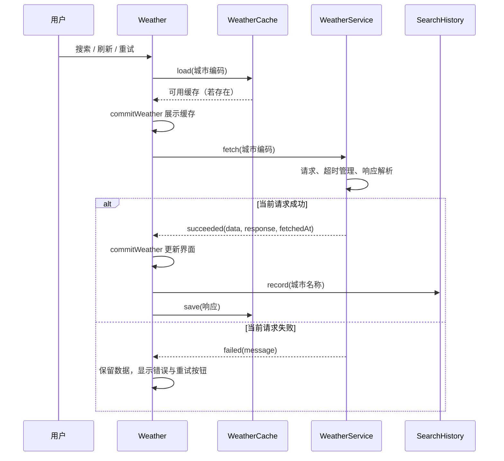

# 第三阶段：模块拆分与可测试性

## 本阶段结果

将网络请求和搜索历史从 Weather 窗口拆出。保留第二阶段先缓存后联网、30 分钟过期、失败保留数据、刷新与重试规则。天气接口及历史存储格式保持一致。

## 模块职责

| 模块 | 职责 |
| --- | --- |
| Weather（weather.h / weather.cpp） | 接收用户操作、确定目标城市、协调缓存和服务、更新控件与绘图 |
| WeatherService | 发起请求、10 秒超时、同城请求去重、取消、过滤旧响应、分类错误，发出成功或失败信号 |
| WeatherData | 解析与校验响应，输出 Today 和 Forecast 数据 |
| WeatherCache | 读取与原子写入缓存、检查有效性和过期时间 |
| SearchHistory | 过滤无效城市、去重、最近 20 条排序、QSettings 持久化 |
| WeatherTool / CityComboBox | 城市编码映射、中文与拼音候选交互 |

Weather 仍承担缓存协调和显示状态；本次未引入额外控制器，也未改写绘图控件。

## 一次查询怎样流转



## 关键设计及学习顺序

1. 先读 WeatherService.h：公开 fetch、cancel、isActive 和超时设置接口，成功与失败通过 Qt 信号通知窗口。
2. 再读 WeatherService.cpp：每次取消先增加请求编号，再 abort。abort 可能同步触发 finished，编号必须提前失效。
3. 响应只有编号和活动 reply 都匹配时才允许发出结果。旧响应不会触发界面、缓存或历史更新。
4. Weather 构造时连接信号，requestWeather 负责城市校验和缓存展示；所有展示数据仍统一提交到 commitWeather。
5. SearchHistory 沿用 IniFormat/UserScope、WeatherProject/Weather、search/recentCities，启动加载不改变记录顺序。

## 网络注入与对象生命周期

Weather 的第三个可选构造参数是 QNetworkAccessManager 指针，会传给 WeatherService。普通运行不传参数，由服务创建并拥有网络管理器；测试传模拟管理器，使测试无需外部接口。

外部注入的管理器由调用者拥有，必须比服务存活更久，并与服务处于同一线程。当前信号连接在同一线程直接执行。WeatherService 只监听自己创建的 reply，不接管管理器的其他请求。窗口关闭和服务析构都会取消活动请求。

## 测试

在项目根目录执行：

```powershell
powershell -ExecutionPolicy Bypass -File tests/run-stage1.ps1
powershell -ExecutionPolicy Bypass -File tests/run-stage2.ps1
powershell -ExecutionPolicy Bypass -File tests/run-stage3.ps1
```

- 第一阶段：解析、去重、快速切换城市、HTTP/网络/超时/非法响应、刷新、重试、关闭窗口。
- 第二阶段：缓存持久化、有效期与跨日、损坏和非法文件、缓存展示、失败保留缓存、写入失败、旧响应不能覆盖缓存。
- 第三阶段：QCoreApplication 下直接测试服务和历史，不创建窗口；覆盖取消和析构、旧响应、超时、HTTP/网络/数据错误、历史上限/去重/持久化/非法城市过滤。
- tests/TestSupport.h 提供可控制延迟、HTTP 状态和取消行为的模拟响应及天气夹具。
- 历史与缓存使用临时目录，窗口测试通过构造参数注入模拟网络。

三个脚本本次均通过。窗口回归使用 offscreen，未验证原生窗口外观或输入法交互。

## 可用于简历的表述

基于 Qt Widgets 开发天气查询应用，将异步请求、JSON 校验、本地缓存与搜索历史拆分为独立模块；通过请求编号过滤过期响应，支持超时重试与离线展示，并使用可注入网络管理器及临时目录实现可重复自动化测试。

面试时可以结合 WeatherService::cancel 解释同步取消回调和旧响应问题，再演示断网缓存与模拟网络测试。不要把本次拆分描述成完整 MVC 框架或多线程网络架构。
